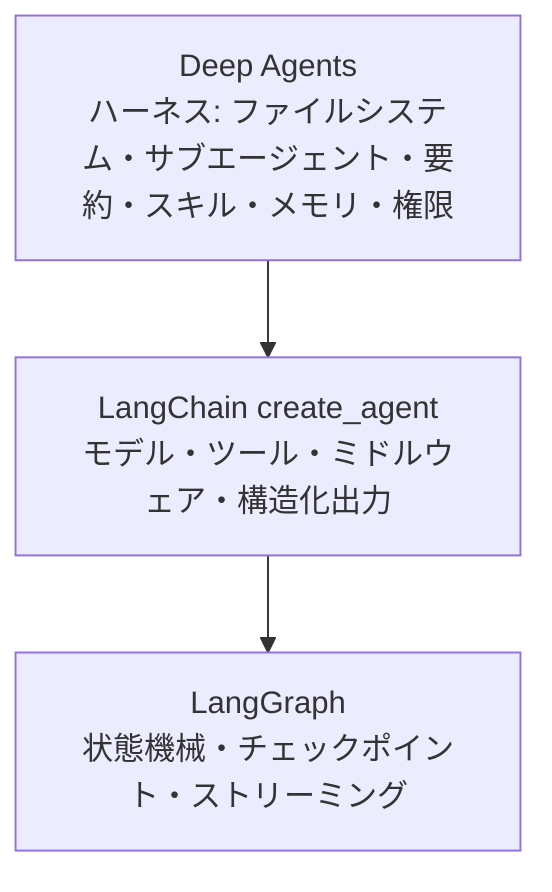
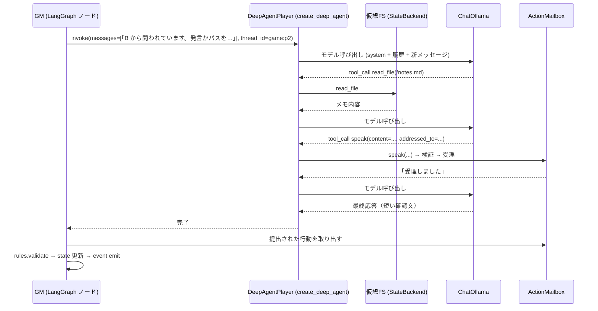
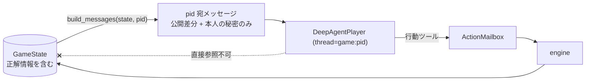

# OneNightAgents AI プレイヤー設計（Deep Agents・推論・情報隔離）

本書は Deep Agents の調査結果、プレイヤーを Deep Agent として実装する具体的な構成、機能配置、プロンプトとツール、性格・戦略の切り替え、情報隔離、観察・分析のためのログ設計を定める。
ゲーム仕様は [game-design.md](game-design.md)、全体構成と観測基盤は [architecture.md](architecture.md)、実装順序と実験計画は [implementation-plan.md](implementation-plan.md) を参照。

- 作成日: 2026-10-14（改訂 1: Deep Agents を初期版から主軸に変更）
- ステータス: 設計案（未実装）

---

## 0. 本書の前提

本プロジェクトは **Deep Agents の学習・理解** を重要な目的に含む。したがって:

- 初期版から各 AI プレイヤーを `create_deep_agent` で実装する。
- ハーネスの機能（仮想ファイルシステム、権限、要約、スキル、メモリ、サブエージェント、ミドルウェア）は「使うべき理由がある順」に段階的に有効化し、**有効化のたびに LangSmith のトレースで挙動・時間・トークンを観察して、残すか外すかを決める**。
- 最初から完成度の高い構成を目指さない。まず 1 ゲームが動く最小構成を作り、観察に基づいて改善する。

---

## 1. Deep Agents の調査結果

参照: [Deep Agents overview](https://docs.langchain.com/oss/python/deepagents/overview)、[Customize](https://docs.langchain.com/oss/python/deepagents/customization)、[Backends](https://docs.langchain.com/oss/python/deepagents/backends)、[Subagents](https://docs.langchain.com/oss/python/deepagents/subagents)、[Skills](https://docs.langchain.com/oss/python/deepagents/skills)、[Memory](https://docs.langchain.com/oss/python/deepagents/memory)、[Permissions](https://docs.langchain.com/oss/python/deepagents/permissions)、[Models](https://docs.langchain.com/oss/python/deepagents/models)、[Streaming](https://docs.langchain.com/oss/python/deepagents/streaming)、[`create_deep_agent` リファレンス](https://reference.langchain.com/python/deepagents/graph/create_deep_agent)

### 1.1 位置づけ

Deep Agents は LangChain の `create_agent`（ツール呼び出しループ）の上に、あらかじめ組み立てたミドルウェアスタック（ハーネス）を載せたもの。LangGraph の上で動く。



### 1.2 主要機能と本プロジェクトでの使い方

| 機能 | 内容（公式ドキュメントより） | 本プロジェクトでの使い方 | 導入段階 |
| --- | --- | --- | --- |
| 組み込み FS ツール | `ls` `read_file` `write_file` `edit_file` `glob` `grep` `delete`（sandbox なら `execute`） | 推理メモ `/notes.md` の読み書き。許可リストで `read_file` `write_file` `edit_file` `ls` に限定 | 初期版 |
| バックエンド | `StateBackend`（既定。LangGraph state 内の仮想 FS、スレッド単位）、`FilesystemBackend`、`StoreBackend`（スレッド横断）、`CompositeBackend`（パス振り分け）、`LocalShellBackend` | `StateBackend` をプレイヤー別スレッドで使う。ゲームをまたぐ学習メモは `CompositeBackend` + `StoreBackend` で `/memories/` に | 初期版 / 第 3 段階 |
| カスタムツール | `tools=[...]` で関数を渡す | **GM への行動提出ツール**（発言・投票・夜の行動）。これがプレイヤーと GM の接点 | 初期版 |
| 構造化出力 | `response_format=` で `structured_response` に格納 | 使わない。行動はツール呼び出しで受け取る方が、スキーマが判断ごとに変わる本ゲームに合う（2.3） | — |
| ミドルウェア | `middleware=[...]`。`.name` が一致すると既定を置換 | 計測用カスタムミドルウェア、`ModelCallLimitMiddleware`、`ModelRetryMiddleware`、必要なら `SummarizationMiddleware` の閾値変更 | 初期版 |
| 要約 | `SummarizationMiddleware`（既定で有効）。`trigger=("tokens", n)` `keep=("messages", m)` | プレイヤーのスレッドが伸びたときに発火させる。発火位置と要約内容をトレースで観察 | 初期版（既定のまま）→ 閾値調整 |
| 権限 | `permissions=[FilesystemPermission(...)]`。allow / deny / interrupt、先勝ち | `/notes/**` 以外の書き込みを deny。拒否時の挙動を観察 | 第 2 段階 |
| スキル | `skills=["/skills/"]`。SKILL.md を必要時に読み込む。`StateBackend` では `invoke(files={...})` + `create_file_data()` で渡す | 役職別の戦術書（占い師の CO 判断、人狼の騙り方）。読み込まれるか、読み込みが有利に働くかを観察 | 第 2 段階 |
| メモリ | `memory=["/memory/AGENTS.md"]` を起動時に system prompt に注入 | ペルソナ定義の注入。ゲーム横断で agent 自身が更新する「学習メモ」の実験 | 第 3 段階 |
| サブエージェント | `subagents=[...]`。親が `task` ツールで委譲。`general-purpose` が自動追加 | 初期版は無効化（`GeneralPurposeSubagentProfile(enabled=False)`）。第 3 段階で「反論役」サブエージェントを実験 | 無効 → 第 3 段階 |
| 計画 | `TodoListMiddleware` を渡すと `write_todos`（v0.7 からオプトイン） | 使わない（1 判断が短い）。学習目的で 1 度試して観察するのは可 | 任意 |
| Human-in-the-loop | `interrupt_on={tool: True}` | 人間プレイヤーモードで利用候補 | 第 3 段階 |
| LangSmith | サブエージェント名が `lc_agent_name` メタデータに付く | プレイヤー名・役職・フェーズを自前メタデータで付与して絞り込む | 初期版 |
| モデル | ツール呼び出し対応の任意のチャットモデル。`"ollama:<model>"` または `ChatOllama` インスタンス。`model=None` は非推奨 | `ChatOllama` インスタンスを渡す（`num_ctx` 等を設定するため） | 初期版 |

### 1.3 重要な制約（設計で受け止めるもの）

- **ツール呼び出しが前提。** ツール対応モデルが必須で、小型ローカルモデルの安定性は公式評価にない（公式評価の open-weight はクラウド大型モデル中心）。→ 最初の検証対象。
- **1 判断が複数ステップになる。** メモを読む → 考える → メモを書く → 行動を提出、で 3〜4 回のモデル呼び出しになりうる。→ `ModelCallLimitMiddleware` で上限を設け、ステップ数をトレースで観察する。
- **プレイヤーごとの会話履歴が伸びる。** ワンナイト 1 ゲームで 20〜30 回のやり取り。→ `num_ctx` を大きめに取り、要約の発火を観察する。
- **サブエージェントは親にすべて戻る。** 人狼の情報隔離はプレイヤー単位のスレッド分離で担保し、サブエージェントはプレイヤー内部でのみ使う。

---

## 2. 採用方式

### 2.1 比較（再掲）

| 構成 | 概要 | 判定 |
| --- | --- | --- |
| (a) 各プレイヤーを独立した Deep Agent | プレイヤー数ぶんの `create_deep_agent`。各自がスレッドと仮想 FS を持つ | **採用**（(c) と組み合わせ） |
| (b) 親 Deep Agent + サブエージェント | GM を LLM の親にする | 不採用。GM が非決定的になり、親が全員の情報を見る |
| (c) LangGraph でゲーム進行、Deep Agents でプレイヤー | 進行は決定的グラフ。プレイヤーは (a) | **採用** |
| (d) 通常の LLM 呼び出しでプレイヤー | 1 判断 1 呼び出し | 比較用ベースライン（`SimpleLLMPlayer`）として後から追加 |

### 2.2 結論

**(c) を採用する。** GM は決定的な Python（LangGraph の StateGraph）、各プレイヤーは `create_deep_agent` で作った独立エージェント。プレイヤーは `Player` プロトコルの裏に隠すので、比較用の `SimpleLLMPlayer` や `ScriptedPlayer` と同じ GM で混在できる。

### 2.3 DeepAgentPlayer の初期構成

```python
# 初期版の構成案。実装時に create_deep_agent のリファレンスで引数名を再確認する。
from deepagents import create_deep_agent, GeneralPurposeSubagentProfile, HarnessProfile, register_harness_profile
from deepagents.backends import StateBackend
from deepagents.middleware import FilesystemMiddleware
from langchain.agents.middleware import ModelCallLimitMiddleware, ModelRetryMiddleware
from langgraph.checkpoint.memory import InMemorySaver

backend = StateBackend()
mailbox = ActionMailbox()  # 行動提出ツールが書き込む先。GM が invoke 後に読み出す

agent = create_deep_agent(
    model=chat_ollama,                                  # ChatOllama(model=..., num_ctx=16384, reasoning=False, ...)
    system_prompt=build_system_prompt(rules, persona),  # 固定部分のみ
    tools=[mailbox.speak, mailbox.pass_turn, mailbox.vote, mailbox.seer_look, mailbox.thief_swap],
    backend=backend,
    middleware=[
        FilesystemMiddleware(backend=backend, tools=["read_file", "write_file", "edit_file", "ls"]),
        ModelCallLimitMiddleware(run_limit=4, exit_behavior="end"),   # 1 判断あたりのモデル呼び出し上限
        ModelRetryMiddleware(max_retries=2),
        trace_metrics_middleware,                       # 自前: レイテンシ・トークンを JSONL にも記録
    ],
    checkpointer=InMemorySaver(),                       # 1 ゲーム内でスレッドを維持（StateBackend のファイルもここに乗る）
    name=f"player-{player_id}",
)
# general-purpose サブエージェント（task ツール）はハーネスプロファイルで無効化する
```

要点:

- **プレイヤー = 長寿命のスレッド。** `thread_id = f"{game_id}:{player_id}"` で、ゲーム中は同じスレッドに GM からのメッセージを追加していく（夜の通知 → 発言要求 → … → 投票要求）。エージェントは自分の履歴と `/notes.md` を持ち、Deep Agents らしい「記憶を持つエージェント」として振る舞う。
- **行動はツールで提出する。** 発言・パス・投票・夜の行動はカスタムツール（`speak(content, addressed_to, claimed_role)` など）を呼ぶことで GM に届く。ツール引数は Pydantic で検証し、フェーズ外の呼び出しや無効な対象はツールがエラー文字列を返す（モデルが修正できる）。ツール呼び出しは LangSmith のトレースにそのまま現れるので、観察目的にも合う。
- **`response_format` は使わない。** 判断ごとにスキーマが変わる（発言 / 投票 / 占い / 交換）ため、1 つの `response_format` では表現しにくい。ツール方式なら「どのツールを呼ぶべきか」をプロンプトで指示するだけで済む。
- **行動が提出されなかった場合**（ツールを呼ばずに文章だけ返した、上限に達した）は、GM が 1 回だけ「ツールで提出してください」と再要求し、それでも無ければ決定的フォールバック（[game-design.md](game-design.md) 3.3）。
- **推理メモ** は、エージェントが任意に `/notes.md` に書くのに加え、GM が夜明け後と投票前に「メモを更新してください」と明示的に求める。GM は invoke 後にエージェントの state からファイルを読み出してログに残す（取得方法は実装時に `StateBackend` のリファレンスで確認する）。



### 2.4 段階的に有効化する機能（学習と観察の順序）

| 段階 | 有効化する機能 | 観察したいこと |
| --- | --- | --- |
| 初期版 | FS ツール（許可リスト）、カスタム行動ツール、`ModelCallLimit`、`ModelRetry`、既定の要約、LangSmith | ツール選択の正しさ、1 判断あたりのステップ数と時間、メモを自発的に書くか、要約が発火するか |
| 第 2 段階 | `permissions`、`skills`（役職別戦術）、`SimpleLLMPlayer` との比較 | 権限拒否時の回復、スキルを読むか、読むと勝率や騙りが変わるか、ハーネスの有無でのテンポ差 |
| 第 3 段階 | サブエージェント（反論役）、`memory` + `StoreBackend`（ゲーム横断の学習メモ）、`interrupt_on`（人間参加） | 委譲が推理の質を上げるか、学習メモが戦術に反映されるか |

---

## 3. AI プレイヤーの機能配置

| 機能 | 実装箇所 | 方式 | 備考 |
| --- | --- | --- | --- |
| 自分の役職の認識 | GM からの通知メッセージ（夜の結果） | スレッド内の HumanMessage | 「交換されている可能性」は system prompt のルール要約に明記 |
| 他者の発言の理解 | GM からの差分メッセージ（前回以降の公開ログ） | 1 発言 1 行 | 全文を毎回送らない。履歴はスレッドが持つ |
| 役職の推理 | エージェント（`/notes.md`） | FS ツール | 夜明け後・投票前に GM が更新を要求 |
| 嘘をつくかの判断 | エージェント + system prompt の許可 + ペルソナ | — | `/notes.md` の「主張する役職」欄で意図を観察 |
| 発言内容の生成 | エージェント → `speak` ツール | ツール呼び出し | 短文制約は引数の `max_length` と指示 |
| 発言タイミング | エージェント → `pass_turn` ツール + GM のスケジューラ | — | 入札方式は第 2 段階 |
| 夜の行動・投票 | エージェント → `seer_look` / `thief_swap` / `vote` ツール | ツール呼び出し | 候補は GM のメッセージで提示。ツール側でも検証 |
| 過去の発言・推理状態の保持 | スレッド（チェックポイント）+ 仮想 FS | Deep Agents 標準 | 1 ゲーム = 1 スレッド |
| 新情報に基づく推理の更新 | エージェント（差分メッセージを受けて） | — | 更新されたかはトレースと `/notes.md` の差分で観察 |

**いつ・誰が・何を選べるか**は GM（Python）が決め、エージェントは「内容」だけを決める。この分離は Deep Agents を使っても変えない。

---

## 4. プロンプトとツール

### 4.1 system prompt（固定）

```text
あなたは「ワンナイト人狼」のプレイヤー {display_name} です。
## ルール要約（役職・夜の順序・投票・平和村・勝敗。短く）
## このゲームの注意
- 役職は夜の怪盗によって交換されている可能性があります。
- 嘘をついてもかまいません。役職を偽って主張してもかまいません。
- 発言は短く、1〜3 文にしてください。
## 行動の提出方法
- ゲームマスターから求められたら、必ず対応するツール（speak / pass_turn / vote / seer_look / thief_swap）を 1 回だけ呼んで行動を提出してください。
- 推理メモは /notes.md に保存できます。必要なときに read_file / write_file / edit_file を使ってください。
## あなたの性格と方針
{persona_text}
```

### 4.2 GM からのメッセージ（スレッドに追加）

| 場面 | 内容 |
| --- | --- |
| ゲーム開始 | 参加者一覧、あなたの配布役職 |
| 夜（占い師） | 「占う対象を seer_look で選んでください。候補: p1, p3, p4, center。候補に優劣はありません。迷う場合は p3 を選んでください」。「迷う場合は」は GM が seed の乱数で選んだ候補（025。夜は情報がなく、モデルは最小の ID を選ぶ癖がある） |
| 夜明け | 夜の結果（役職別）。「/notes.md に推理メモを書いてください」 |
| 発言ターン | 前回以降の発言（差分）、ラウンド、「speak か pass_turn で提出」。応答ターンなら「B から問われています」 |
| 投票前 | 差分、「/notes.md を更新したうえで vote で投票してください」 |
| 終了 | 全公開情報（学習メモ実験のため、第 3 段階で「振り返りを /memories/ に書く」要求を追加） |

### 4.3 行動ツールのスキーマ（`players/tools.py`）

```python
class SpeakArgs(BaseModel):
    content: str = Field(max_length=200, description="発言本文。1〜3文")
    addressed_to: str | None = Field(default=None, description="質問や反論の宛先プレイヤーID")
    claimed_role: Literal["villager", "werewolf", "seer", "thief"] | None = Field(default=None, description="この発言で主張する自分の役職。嘘でもよい")

class VoteArgs(BaseModel):
    target: str = Field(description="処刑したいプレイヤーID。自分は不可")
    reason: str = Field(max_length=200, description="理由の要約。公開されない")

class SeerLookArgs(BaseModel):
    target: str = Field(description="プレイヤーID または 'center'")

class ThiefSwapArgs(BaseModel):
    target: str | None = Field(description="交換相手のプレイヤーID。交換しないなら null")
```

- 候補の検証（存在するか、自分でないか、フェーズが合うか）はツール本体で行い、違反時は理由を返り値で返してモデルに修正させる。最終的な適用可否は GM の `rules.validate_*` が判断する（二重防御）。
- ツールの返り値は短い文字列（「受理しました」「無効: 自分には投票できません」）にして履歴を膨らませない。

### 4.4 性格・戦略の切り替え

- `configs/personas/*.yaml`（`name`, `style`, `risk`, `talkativeness`, `deception`, `notes`）を `persona_text` に描画。
- 第 2 段階: 役職別戦術を `skills/<role>/SKILL.md` に書き、`skills=` で渡す。スキルが読まれたか（`read_file` の呼び出し）と効果をトレースで比較。
- 第 3 段階: `memory=["/memories/AGENTS.md"]` + `StoreBackend` で、エージェント自身がゲーム後に振り返りを書き、次のゲームで読む「学習メモ」を実験する。
- プレイヤーごとにモデル・温度・`reasoning` を変えられるようにする（初期版は 1 モデル共有を推奨）。

---

## 5. 情報隔離

### 5.1 情報の分類

| 区分 | 内容 | 保持場所 | 誰が見られるか |
| --- | --- | --- | --- |
| 公開情報 | 参加者名、ルール、公開ログ、フェーズ、（終了後）投票・全役職・中央 | GM の `GameState` の公開部分 | 全員・観戦者 |
| 配布時の秘密 | 自分の初期役職 | `GameState.initial_roles` → 本人のスレッドにのみ通知 | 本人のみ |
| 夜に得た秘密 | 占い結果 / 相方 / 交換結果 | `GameState.night` → 行動者のスレッドにのみ通知 | 本人のみ |
| 推理メモ | `/notes.md` | 本人のスレッドの仮想 FS（`StateBackend`） | 本人のみ。観戦の `--reveal` で表示可 |
| 投票 | 投票先と理由 | `ActionMailbox` → `GameState.votes` | 投票中は誰にも見せない。終了後に投票先のみ公開 |
| 正解情報 | 中央カード、交換後の全役職 | `GameState.center` / `current_roles` | 終了まで誰にも見せない |

### 5.2 構造による保証



1. **唯一の出口**: プレイヤーに渡るのは `build_messages(state, pid)` が作るメッセージだけ。`players` パッケージは `engine` を import しない。
2. **スレッド分離**: プレイヤーごとに `thread_id` を分ける。`StateBackend` のファイルはスレッドの state にあるので、他プレイヤーの `/notes.md` は見えない。チェックポインタは共有してよい。
3. **ツールの範囲**: FS ツールは許可リストで `read_file` `write_file` `edit_file` `ls` のみ。`execute` は `StateBackend` では提供されない。`task`（サブエージェント）は無効。行動ツールは `ActionMailbox` に書くだけで、ゲーム状態を読めない。
4. **メッセージ生成の単体テスト**: 全フェーズ・全役職について `build_messages` の出力を直列化し、他者の役職・中央・他者の夜情報・他者の投票が含まれないことを検証。
5. **ログの分離**: 観戦表示は公開イベントのみ。秘密は終了後または `--reveal`。
6. **LangSmith**: トレースには全プレイヤーの秘密が含まれる（観察目的なので意図どおり）。プレイヤーがトレースを読む経路はない。

---

## 6. 観察・分析のためのログ

### 6.1 観察の 2 系統

| 系統 | 何が見えるか | 用途 |
| --- | --- | --- |
| LangSmith トレース | ゲーム 1 回 = 1 トレース。GM のノード → 各プレイヤーのエージェント実行 → モデル呼び出し（入力・出力・トークン・時間）→ ツール呼び出し（引数・返り値）→ 要約・再試行 | 推論過程・ツール呼び出し・状態遷移・時間・トークンの観察。プロンプト改善の主戦場 |
| ローカル JSONL（`runs/<id>/`） | ゲームイベント（公開/秘密）、行動、`/notes.md` のスナップショット、呼び出しごとの計測 | バッチ集計（勝率・フォールバック率・レイテンシ分布）、リプレイ、LangSmith なしでの再現 |

LangSmith の設定（`LANGSMITH_TRACING` 等）と付与するメタデータは [architecture.md](architecture.md) 10 節。

### 6.2 初期版で記録するもの

| 目的 | 記録 | 取得元 |
| --- | --- | --- |
| 発言ログ | `utterance` イベント | GM |
| 各 AI が把握していた情報 | `roles_assigned` / `night_action` + プレイヤー宛メッセージ全文 | GM |
| 推理・疑惑の変化 | `notes_updated`（`/notes.md` の全文を判断のたびにスナップショット。差分があれば記録） | エージェント state |
| 投票理由 | `vote_cast.reason` | `vote` ツール引数 |
| 推論過程 | モデルの出力テキスト、`reasoning_content`（`reasoning=True` 時）、ツール呼び出し列 | トレース + `llm_call` イベント |
| 時間・トークン | 1 判断あたりのモデル呼び出し回数、合計レイテンシ、`prompt_eval_count` / `eval_count` | 計測ミドルウェア + トレース |
| フォールバック | 再要求・フォールバックの発生 | GM |

LLM の非公開内部推論は前提にしない。`/notes.md`、`vote.reason`、ツール呼び出しの順序、要約前後の履歴が「判断根拠」の観察対象になる。

### 6.3 分析（`analysis/summarize.py`）

- 勝率: 設定ごとに陣営別。`RandomPlayer` 同士をベースラインに。
- 役職主張の分析: `claimed_role` と `initial_roles`/`current_roles` の突き合わせ。嘘 CO の回数と処刑回避率。
- 推理の推移: `/notes.md` スナップショットから「疑っている相手」を抽出（初期版は目視。構造化は後で）。
- エージェント挙動: 1 判断あたりのステップ数分布、メモを書いた判断の割合、スキル読み込み率（第 2 段階）、要約発火回数。
- 同条件の再実行: seed 固定で配役を揃え、設定 A/B を同じ seed 集合で比較。
- 情報別の集計: 村側が根拠にできる夜の情報で配役を分け(占い = 人狼を指す占い結果が終了時も正しい、怪盗 = 怪盗が村側カードと交換、なし、人狼なし)、種類ごとに村側の票の行き先(人狼票・真占い師票)を出す。勝率は配役の運で動くので、A/B の主指標はこの票の行き先(017 / 018 / 022)。

---

## 7. 未決事項（エージェント）

- `/notes.md` の更新を GM がどの程度強制するか（毎ターン要求すると遅い。2 回だけだと更新されないかもしれない）。観察して決める。
- 1 判断あたりの `ModelCallLimit` の値（4 を仮置き）。
- 要約の閾値（既定のままか、`num_ctx` に合わせて下げるか）。
- 行動ツール方式で小型モデルが「ツールを呼ばずに文章で答える」頻度。高ければ `response_format` 方式や `SimpleLLMPlayer` へ寄せる。
- スレッド持続（履歴累積）と毎回フルコンテキスト再構築のどちらが安定するか。前者で始め、履歴肥大が問題なら後者を試す。
