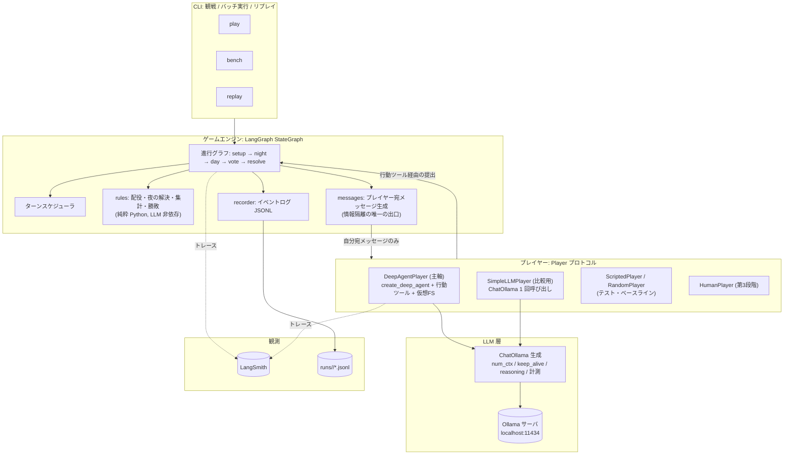
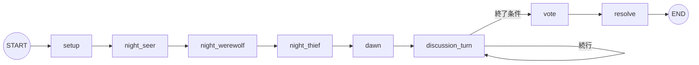
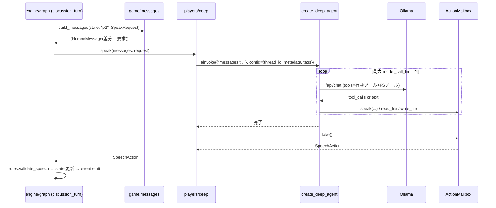

# OneNightAgents システムアーキテクチャ設計

本書はシステム全体の構成、技術選定とそのトレードオフ、モジュールの責務、データモデル、非同期・エラー処理・ログの方針、観測（LangSmith）基盤、Ollama の利用とパフォーマンス方針を定める。
ゲーム仕様は [game-design.md](game-design.md)、AI プレイヤーの内部設計は [agent-design.md](agent-design.md)、実装順序と実験計画は [implementation-plan.md](implementation-plan.md) を参照。

- 作成日: 2026-10-14（改訂 1: Deep Agents を初期版から主軸に、LangSmith による観察駆動の改善を基本方針に変更）
- ステータス: 設計案（未実装）

---

## 1. 設計原則

1. **ゲームロジックと LLM 判断の分離。** ルール（配役・夜の処理・集計・勝敗）は LLM に依存しない純粋な Python。LLM はプレイヤーインターフェースの裏側でのみ動く。
2. **ゲームマスター（GM）は Python プログラム。** 進行・判定は決定的で再現可能。LLM の GM は採用しない（4 節）。
3. **情報隔離は構造で保証する。** プレイヤーは自分宛のメッセージと自分のスレッドしか持たない。エンジンの正解情報を参照できる経路を作らない。
4. **Deep Agents を初期版から使い、挙動を観察して改善する。** 各プレイヤーは `create_deep_agent` で作る。ハーネスの機能は段階的に有効化し、LangSmith のトレースで推論過程・ツール呼び出し・状態遷移・時間・トークンを見てから残す/外すを決める。
5. **まず動くものを作る。** 完成度より「1 ゲームが通ってトレースが取れる」状態を最優先し、以後は 仮説 → 変更 → 計測 → 判断 のサイクルで改善する。
6. **小さく始める。** 1 台の PC、1 つの Ollama サーバ、CLI。ネットワーク対応や Web UI のための抽象化は入れない。

---

## 2. 技術スタック

| 層 | 採用 | 代替案 | 選定理由 |
| --- | --- | --- | --- |
| 言語 | Python 3.12+ | TypeScript | Deep Agents / LangGraph の Python 版が最も情報が多く、`langchain-ollama` が成熟 |
| パッケージ管理 | uv | pip / poetry | `uv sync` / `uv run` の運用 |
| プレイヤー実装 | **Deep Agents（`create_deep_agent`）** | `create_agent` / 直接 `ChatOllama` | 本プロジェクトの学習目的。仮想 FS・要約・スキル・メモリ・ミドルウェアを段階的に試す。比較用に `SimpleLLMPlayer`（直接呼び出し）も後で用意 |
| モデル接続 | `langchain-ollama` の `ChatOllama` | OpenAI 互換 API | ツール呼び出し、`reasoning` 制御、`num_ctx` / `keep_alive`、タイミング情報を扱える。Deep Agents にインスタンスを渡せる |
| 出力検証 | Pydantic v2 | — | ツール引数スキーマと検証 |
| 進行制御 | LangGraph Graph API | 素の asyncio | ゲーム 1 回を 1 つのグラフ実行にすると、LangSmith で「ゲーム → ノード → プレイヤーのエージェント → モデル/ツール」の階層トレースになる。ストリーミング、チェックポイント、`interrupt()` も使える |
| 観測 | **LangSmith**（トレース）+ ローカル JSONL | ローカルのみ | 推論過程・ツール呼び出し・トークン・時間を UI で追える。JSONL はバッチ集計と LangSmith なしの再現用 |
| 可視化 | LangSmith Studio（`langgraph dev`） | — | グラフの状態遷移を対話的に確認（任意） |
| CLI | `argparse` または `typer` | TUI | 観戦表示は標準出力で十分 |
| テスト | pytest + `GenericFakeChatModel` | — | LangChain 公式のモックモデル |

参照した公式ドキュメント:

- Deep Agents: [overview](https://docs.langchain.com/oss/python/deepagents/overview), [customization](https://docs.langchain.com/oss/python/deepagents/customization), [backends](https://docs.langchain.com/oss/python/deepagents/backends), [subagents](https://docs.langchain.com/oss/python/deepagents/subagents), [skills](https://docs.langchain.com/oss/python/deepagents/skills), [memory](https://docs.langchain.com/oss/python/deepagents/memory), [permissions](https://docs.langchain.com/oss/python/deepagents/permissions), [models](https://docs.langchain.com/oss/python/deepagents/models), [streaming](https://docs.langchain.com/oss/python/deepagents/streaming), [`create_deep_agent`](https://reference.langchain.com/python/deepagents/graph/create_deep_agent)
- LangChain: [`create_agent`](https://reference.langchain.com/python/langchain/agents/factory/create_agent), [構造化出力](https://docs.langchain.com/oss/python/langchain/structured-output), [カスタムミドルウェア](https://docs.langchain.com/oss/python/langchain/middleware/custom), [組み込みミドルウェア](https://docs.langchain.com/oss/python/langchain/middleware/built-in), [LangSmith Observability](https://docs.langchain.com/oss/python/langchain/observability), [Unit testing](https://docs.langchain.com/oss/python/langchain/test/unit-testing)
- `ChatOllama`: [クラス](https://reference.langchain.com/python/langchain-ollama/langchain_ollama/chat_models/ChatOllama), [`with_structured_output`](https://reference.langchain.com/python/langchain-ollama/langchain_ollama/chat_models/ChatOllama/with_structured_output)
- LangGraph: [Graph API](https://docs.langchain.com/oss/python/langgraph/graph-api), [streaming](https://docs.langchain.com/oss/python/langgraph/streaming), [persistence](https://docs.langchain.com/oss/python/langgraph/persistence), [Studio](https://docs.langchain.com/oss/python/langgraph/studio), [local server](https://docs.langchain.com/oss/python/langgraph/local-server)
- LangSmith: [Trace LangChain applications](https://docs.langchain.com/langsmith/trace-with-langchain)（metadata / tags / run_name / `ls_model_name`）, [Cost tracking](https://docs.langchain.com/langsmith/cost-tracking), [Metadata parameters](https://docs.langchain.com/langsmith/ls-metadata-parameters)
- Ollama: [FAQ](https://docs.ollama.com/faq), [Chat API](https://docs.ollama.com/api/chat), [structured outputs](https://docs.ollama.com/capabilities/structured-outputs), [tool calling](https://docs.ollama.com/capabilities/tool-calling), [thinking](https://docs.ollama.com/capabilities/thinking)

---

## 3. システム全体構成



責務の要点:

- **エンジン**は `GameState`（正解情報を含む）を保持し、プレイヤーには自分宛メッセージだけを渡す。
- **プレイヤー**はメッセージを受け取り、行動ツールで GM に行動を提出する。内部で Deep Agent を動かすか、1 回の呼び出しで済ませるかはエンジンから見えない。
- **LLM 層**はモデル生成と計測を一箇所に集める。
- **観測**はゲーム全体を 1 トレースにし、ローカル JSONL にも同じ事実を残す。

---

## 4. ゲームマスター（GM）の設計

### 4.1 LLM か Python か

| 観点 | Python GM | LLM GM |
| --- | --- | --- |
| ルール適用の正確さ | 常に正しい | 誤判定が起こり得る |
| 再現性 | 完全 | 保証されない |
| テスト | 単体テストで網羅 | 評価が難しい |
| 推論コスト | 0 | 進行のたびに推論 |
| 情報隔離 | コードで保証 | プロンプト頼み |
| 演出 | 固定テンプレート | 自然な語り |

**結論: GM は Python。** 演出が欲しくなれば、公開情報だけを入力にした「ナレーター」を後から足す（判定には関与させない）。

### 4.2 GM の責務

| 責務 | 実装箇所 | 備考 |
| --- | --- | --- |
| ゲーム状態の管理 | `GameState`（LangGraph の state） | 正解情報を含む |
| 役職の割り当て | `rules.assign_roles(config, rng)` | `random.Random(seed)` |
| 夜のアクション実行 | `rules.resolve_seer / resolve_thief`、人狼は通知のみ | 占い師 → 人狼 → 怪盗 |
| 議論の進行管理 | `discussion_turn` ノード + `scheduler` | ラウンド・応答権・終了条件 |
| 発言権の調整 | `scheduler.next_turn(state)` | 純粋関数。差し替えはここだけ |
| 投票処理 | `rules.tally(votes)` | 同票・全員 1 票 |
| 勝敗判定 | `rules.judge(state)` | 平和村を含む |
| 行動の検証 | 行動ツール内の検証 + `rules.validate_*` | 二重防御。無効なら再要求 → フォールバック |
| プレイヤー宛メッセージ生成 | `messages.build_messages(state, pid)` | 情報隔離の唯一の出口 |
| ログ | `recorder` | JSONL 追記 |

### 4.3 進行グラフ（LangGraph）



- 各ノードは「メッセージを作る → プレイヤーを呼ぶ → 行動を取り出して検証・適用 → イベント emit」の定型。
- `discussion_turn` は 1 ターンだけ処理して条件付きエッジで戻る。ターンごとにチェックポイントが取られ、トレース上も 1 ターン 1 ノード実行として見える。
- プレイヤーオブジェクト（エージェント・チェックポインタ・`ActionMailbox`）はシリアライズできないので state に入れず、`context_schema` のランタイムコンテキストで渡す。
- ゲームのグラフとプレイヤーのエージェント（別の LangGraph グラフ）は **入れ子にしない**。GM ノードの中から `await agent.ainvoke(...)` を呼ぶ。トレースは呼び出し関係で自然に階層化される。

---

## 5. ディレクトリ構成

```text
OneNightAgents/
├── pyproject.toml                 # uv。deps: deepagents, langchain, langchain-ollama, langgraph, langsmith, pydantic
├── .env.example                   # LANGSMITH_TRACING / LANGSMITH_API_KEY / LANGSMITH_PROJECT / OLLAMA_HOST
├── configs/
│   ├── default.yaml               # 人数・ラウンド数・モデル・タイムアウト・call limit
│   └── personas/                  # 性格プロンプト（YAML）
├── skills/                        # 第2段階: 役職別戦術 SKILL.md（Deep Agents の skills= に渡す）
├── src/onenightagents/
│   ├── game/                      # ルール層（LLM 非依存・LangGraph 非依存）
│   │   ├── models.py              # Role, Team, GameConfig, GameState, Utterance, Vote, Event
│   │   ├── rules.py               # 配役・夜の解決・集計・勝敗・検証（純粋関数）
│   │   ├── messages.py            # プレイヤー宛メッセージ生成（情報隔離）
│   │   └── scheduler.py           # 次の発言者の決定（純粋関数）
│   ├── engine/
│   │   ├── graph.py               # StateGraph 定義
│   │   ├── context.py             # ランタイムコンテキスト（プレイヤー登録・recorder）
│   │   └── recorder.py            # JSONL イベントログ
│   ├── players/
│   │   ├── base.py                # Player プロトコル
│   │   ├── mailbox.py             # ActionMailbox と行動ツール（speak / pass_turn / vote / seer_look / thief_swap）
│   │   ├── deep.py                # DeepAgentPlayer（主軸）
│   │   ├── simple.py              # SimpleLLMPlayer（比較用、第2段階）
│   │   ├── scripted.py            # RandomPlayer / ScriptedPlayer
│   │   └── prompts.py             # system prompt とメッセージ文面
│   ├── llm/
│   │   ├── ollama.py              # ChatOllama 生成（num_ctx, keep_alive, reasoning, ls_model_name）
│   │   └── metrics.py             # 計測ミドルウェア（wrap_model_call でレイテンシ・トークンを記録）
│   ├── analysis/
│   │   └── summarize.py           # runs/ の集計
│   └── cli.py                     # play / bench / replay
├── tests/
├── runs/                          # ゲームログ（gitignore）
└── docs/
    └── experiments/               # 実験ノート（仮説・設定・観察・結論）
```

依存の方向は `cli → engine → game`、`engine → players → game`、`players → llm`。`game` は何にも依存しない。`players` は `engine` を import しない。

---

## 6. データモデル

Pydantic v2。ツール引数スキーマは `players/mailbox.py`、ゲーム状態は `game/models.py` に分ける。

### 6.1 ゲーム状態（エンジン専用・秘密情報を含む）

```python
class Role(StrEnum):
    VILLAGER = "villager"; WEREWOLF = "werewolf"; SEER = "seer"; THIEF = "thief"

class GameConfig(BaseModel):
    game_id: str
    seed: int
    players: list[PlayerConfig]        # id, display_name, kind(deep|simple|scripted|human), model, persona
    max_free_rounds: int = 2
    reply_chain_limit: int = 2
    llm_timeout_sec: float = 90.0
    model_call_limit: int = 4          # 1 判断あたりのモデル呼び出し上限（Deep Agent）

class NightRecord(BaseModel):
    seer_target: str | None            # player id or "center"
    seer_result: dict[str, Role] | list[Role] | None
    werewolves: list[str]
    thief_target: str | None
    thief_new_role: Role | None

class Utterance(BaseModel):
    turn: int; round: int; speaker: str
    content: str
    addressed_to: str | None = None
    claimed_role: Role | None = None
    is_pass: bool = False
    reply_to_turn: int | None = None

class Vote(BaseModel):
    voter: str; target: str; reason: str

class GameResult(BaseModel):
    executed: list[str]
    winner: Literal["village", "werewolf", "none"]
    final_roles: dict[str, Role]
    center: list[Role]

class GameState(TypedDict):
    config: GameConfig
    phase: str
    initial_roles: dict[str, Role]
    current_roles: dict[str, Role]
    center: list[Role]
    night: NightRecord
    utterances: list[Utterance]        # 追記 reducer
    delivered_upto: dict[str, int]     # 各プレイヤーに送信済みの発言番号（差分送信用）
    notes_snapshots: dict[str, list[str]]  # /notes.md のスナップショット履歴
    votes: list[Vote]
    result: GameResult | None
    turn_cursor: TurnCursor
```

### 6.2 プレイヤー宛メッセージ（プレイヤーに渡す唯一の情報）

`messages.build_messages(state, pid, request)` が、そのプレイヤーのスレッドに追加する `HumanMessage` を生成する。内容は「前回以降の公開ログ差分」「本人の秘密（夜の結果）」「いま求める行動と候補」のみ。他プレイヤーの役職・中央・他者の夜情報・他者の投票・他者のメモは**一切含めない**ことをテストで保証する。

### 6.3 イベント（ローカルログ）

| event | visibility | 主なフィールド |
| --- | --- | --- |
| `game_started` | public | config |
| `roles_assigned` | secret | initial_roles, center |
| `night_action` | secret | actor, action, result |
| `utterance` | public | Utterance |
| `turn_skipped` | public | player, reason |
| `notes_updated` | secret | player, notes（全文） |
| `vote_cast` | secret（終了後 public） | Vote |
| `game_ended` | public | GameResult |
| `agent_step` | secret | player, purpose, model_calls, tool_calls[], latency_ms, prompt_tokens, completion_tokens, retries, fallback, trace_url |

---

## 7. プレイヤーインターフェースと GM とのやり取り

```python
class Player(Protocol):
    id: str

    async def act_at_night(self, messages: list[BaseMessage], request: NightRequest) -> NightAction: ...
    async def speak(self, messages: list[BaseMessage], request: SpeakRequest) -> SpeechAction: ...
    async def vote(self, messages: list[BaseMessage]) -> VoteAction: ...
    async def update_notes(self, messages: list[BaseMessage]) -> str | None: ...   # /notes.md の内容
```

- `DeepAgentPlayer` は、受け取ったメッセージを自分のスレッド（`thread_id = game_id:player_id`）に追加して `ainvoke` し、`ActionMailbox` から行動を取り出して返す。
- `ScriptedPlayer` / `SimpleLLMPlayer` はメッセージを読んで直接行動を返す。
- GM は返された行動を `rules.validate_*` で検証する。無効なら 1 回だけ再要求（エラー内容を添えたメッセージを追加）、再び無効ならフォールバック。
- `request` は候補（占い対象、投票対象）と制約（パス可否、応答ターンか）を明示し、プレイヤーに「できること」を推測させない。



---

## 8. 非同期処理の方針

- エンジンは `asyncio`。LangGraph のノードは `async def`、プレイヤー呼び出しは `await`。
- **初期版は逐次実行。** Ollama の既定は `OLLAMA_NUM_PARALLEL=1`（[FAQ](https://docs.ollama.com/faq)）。並列に投げても待ち行列に入るだけで、トレースとログの順序が読みにくくなる。
- 独立した判断（夜・投票・メモ更新）は、`OLLAMA_NUM_PARALLEL` を上げて `asyncio.gather` で並列化する実験を第 2 段階で行う。並列度は LLM 層の `asyncio.Semaphore` で制御する。
- 人間プレイヤーは `Player` を実装した `HumanPlayer`（端末入力。[implementation-plan.md](implementation-plan.md) Step 8）。GM が逐次 `await` するので入力待ちは Player の中で足りる。LangGraph の `interrupt()` は、Web UI で中断・再開が必要になったときの選択肢。

---

## 9. エラー処理

| 事象 | 検出 | 対応 |
| --- | --- | --- |
| Ollama 未起動・モデル未取得 | `validate_model_on_init=True` | 起動時に明確なメッセージで終了 |
| モデル呼び出しの一時的失敗 | `ModelRetryMiddleware` | 指数バックオフで再試行（既定 2 回） |
| 判断が終わらない（ツール呼び出しの繰り返し） | `ModelCallLimitMiddleware(run_limit=N, exit_behavior="end")` | 上限で打ち切り。行動未提出なら再要求 → フォールバック |
| 推論タイムアウト | `asyncio.wait_for(…, llm_timeout_sec)` | 1 回再試行 → フォールバック。`turn_skipped` を記録 |
| ツール引数が不正 | Pydantic + ツール内検証 | ツールがエラー文字列を返し、モデルに修正させる（上限内で） |
| 行動未提出・ルール違反 | GM の `rules.validate_*` | 1 回再要求 → 決定的フォールバック |
| 503（キュー溢れ） | HTTP エラー | 再試行。`OLLAMA_MAX_QUEUE` 既定 512 |
| 途中クラッシュ | — | `SqliteSaver` なら同じ `thread_id` で再開（第 2 段階）。初期版は `InMemorySaver` |

フォールバックは決定的（seed 固定）にし、`fallback=True` をログに残す。フォールバック率はモデル・プロンプトの品質指標として毎回見る。

---

## 10. 観測（Observability）

### 10.1 LangSmith

- 有効化: `LANGSMITH_TRACING=true`、`LANGSMITH_API_KEY`、`LANGSMITH_PROJECT=onenightagents`（[Observability](https://docs.langchain.com/oss/python/langchain/observability)）。`.env` に置き、`bench` で無効化できるようにする。
- **トレースの単位**: ゲーム 1 回 = GM グラフの 1 実行 = 1 トレース。その下に `discussion_turn` などのノード、さらに各プレイヤーのエージェント実行（`create_deep_agent` のグラフ）、モデル呼び出し、ツール呼び出し、要約が階層で並ぶ。
- **メタデータとタグ**（[Trace LangChain applications](https://docs.langchain.com/langsmith/trace-with-langchain)）: `RunnableConfig` の `metadata` / `tags` は子 run に継承される。
  - ゲーム実行時（root run）: `metadata={"game_id", "seed", "bench", "model", "kind", "personas", "liar_seer", "reasoning", "num_predict", "temperature"}`, `tags=["onenightagents"]`。`bench` は bench 名で、実験の条件名を兼ねる（`play` では `None`）。
  - プレイヤーの `ainvoke` 時: プレイヤー自身が `metadata={"player_id", "display_name", "purpose"}`, `run_name=f"{player_id}:{purpose}"` を付け、GM が `langsmith.tracing_context(metadata=...)` で `initial_role` と、発言なら `round` / `turn` を重ねる（`engine/graph.py`）。プレイヤーは自分の役職を知らなくてよい。
  - ゲーム終了後: root run に feedback `village_won`（bool）、`wolf_votes`（村側の票のうち人狼に向いた数）、`true_seer_executed`（bool）を付ける（`cli.run_game`）。`summarize` の指標と同じ定義で、弱点のゲームだけをトレースで開く入口にする。root run の id は `RunnableConfig` の `run_id` で先に決める。
  - Deep Agents はエージェント名を `lc_agent_name` メタデータに付ける（[Subagents: LangSmith tracing](https://docs.langchain.com/oss/python/deepagents/subagents#langsmith-tracing)）。`create_deep_agent(name=...)` にプレイヤー名を入れて絞り込みに使う。
- **モデル名**: `ChatOllama(metadata={"ls_provider": "ollama", "ls_model_name": "<model>"})` で、トレース上のモデル名を明示する（[Metadata parameters](https://docs.langchain.com/langsmith/ls-metadata-parameters)）。
- **見るもの**: モデル呼び出しの入力（system + 履歴 + 差分）と出力、ツール呼び出しの引数と返り値、1 判断のステップ数、各 run の latency と token usage、要約が走ったときの前後の履歴、再試行。
- 注意: トレースには全プレイヤーの秘密情報とプロンプト全文が含まれ、LangSmith（クラウド）に送られる。ゲームデータなので問題ないが、`bench` の大量実行では無効化して JSONL のみにする。

### 10.2 ローカル JSONL

- `runs/<game_id>/config.json`、`events.jsonl`（6.3）、`agent_steps.jsonl`（判断ごとの計測。`trace_url` があれば併記）。
- 計測は `@wrap_model_call` のカスタムミドルウェア（[Custom middleware](https://docs.langchain.com/oss/python/langchain/middleware/custom)）で、各モデル呼び出しの壁時計時間と `response_metadata`（`prompt_eval_count`, `eval_count`, `eval_duration` 等）を記録する。LangSmith と二重になるが、バッチ集計と LangSmith なしでの再現のために残す。

### 10.3 LangSmith Studio（任意）

`langgraph.json` を用意して `langgraph dev` を起動すると、GM グラフの状態遷移を Studio で対話的に追える（[Studio](https://docs.langchain.com/oss/python/langgraph/studio)、Python 3.11 以上）。デバッグ用で、ゲームの実行経路としては CLI を正とする。

### 10.4 観察 → 改善のループ

1. 仮説を `docs/experiments/NNN-<slug>.md` に書く（例: 「推理メモを毎ターン要求すると投票の正答率が上がるが、1 ゲーム 2 分遅くなる」）。
2. 設定（`configs/*.yaml`、プロンプト、ミドルウェア）を変える。
3. 同じ seed 集合で実行し、トレース URL と JSONL の集計を記録する。
4. 残す / 戻す / 次の仮説 を書く。

これを開発の基本単位にする。実験ノートの様式は [implementation-plan.md](implementation-plan.md) 4 節。

---

## 11. Ollama とパフォーマンス

### 11.1 接続方法

- `ChatOllama(model=..., base_url="http://localhost:11434", num_ctx=16384, keep_alive="30m", temperature=..., seed=..., reasoning=False, validate_model_on_init=True, metadata={"ls_provider": "ollama", "ls_model_name": ...})` を `llm/ollama.py` で生成し、`create_deep_agent(model=...)` に渡す。
- Deep Agents はツール呼び出しで動くため、**ツール呼び出し対応モデルが必須**（Ollama ライブラリの `tools` タグ）。
- `SimpleLLMPlayer`（比較用）は `with_structured_output(Schema, method="json_schema")` を使う。Ollama の `format` に JSON Schema を渡す制約付き生成で、ツール非対応モデルでも動く。

### 11.2 モデルの条件と候補

条件（優先順）:

1. **ツール呼び出しが安定している**（引数の JSON が正しい、不要なツール呼び出しが少ない、呼ぶべきときに呼ぶ）。Deep Agents の前提。
2. 日本語で自然な短文を生成できる。
3. VRAM に収まり、`num_ctx=16384` の KV キャッシュを含めて 100% GPU で動く（`ollama ps` で確認）。
4. thinking を制御できる（`think=false` が効く、または思考が短い）。

候補（[Ollama ライブラリ](https://ollama.com/library?sort=popular) 2026-10 時点、`tools` タグ付き・ローカルで現実的なサイズ）:

| モデル | サイズ | タグ | 備考 |
| --- | --- | --- | --- |
| qwen3.5 | 4b / 9b / 27b | tools, thinking | 小サイズから揃う |
| qwen3.6 | 27b / 35b | tools, thinking | VRAM 24GB 級向け |
| gemma4 | e4b / 12b / 26b | tools, thinking | 多言語に強い系統 |
| gpt-oss | 20b | tools, thinking | thinking を low/medium/high で指定可 |
| qwen3 | 8b / 14b | tools, thinking | 実績が多い |
| granite4.1 | 8b | tools | 軽量 |
| nemotron-3-nano | 4b / 30b | tools, thinking | 軽量候補 |

gemma3 には `tools` タグがなく、Deep Agents には使えない。Deep Agents 公式評価で良好な open-weight（GLM-5.2 等）はローカル 1 台では現実的でない。**最適モデルは断定せず、Step 0 のスパイクで実測して決める。**

### 11.3 ツール呼び出しと構造化出力の使い分け

| 用途 | 方式 | 理由 |
| --- | --- | --- |
| DeepAgentPlayer の行動提出 | カスタムツール（`speak` / `vote` / …） | 判断ごとにスキーマが変わる。トレースにツール呼び出しとして現れる |
| DeepAgentPlayer の推理メモ | FS ツール（`write_file` / `edit_file`） | ハーネス標準機能 |
| SimpleLLMPlayer（比較用） | `format` = JSON Schema | 1 回で型付き出力。ハーネスの効果を切り分ける基準線 |

### 11.4 複数 AI からの推論要求の管理

- 1 モデルを全プレイヤーで共有する。プレイヤーごとに別モデルは、VRAM に同時に載らなければロード/アンロードが毎回起きる（`load_duration` で観測）。
- `keep_alive` はゲーム中アンロードされない長さ（`30m` など）にし、起動時に空リクエストでプリロード。
- 逐次 vs 並列は 8 節のとおり。Deep Agents では 1 判断が複数呼び出しになるため、並列化の効果はさらに限定的。計測してから判断。

### 11.5 コンテキストの肥大化対策

- プレイヤーのスレッドは履歴が累積する。system（ルール + ペルソナ + ツール定義 ≈ 1.5K）+ 1 ターンあたり差分 + 応答 + ツール往復（≈ 300〜600）× 20〜30 ターンで、投票時に 8〜15K トークンに達しうる。Ollama の既定 4096 では不足するので **`num_ctx` を 16384 に設定**し、`prompt_eval_count` を毎回記録して成長を観察する。
- Deep Agents 既定の `SummarizationMiddleware` がどこで発火するか、発火後に推理が崩れないかをトレースで確認する。必要なら `trigger=("tokens", n)` / `keep=("messages", m)` を `num_ctx` に合わせて下げる。
- 履歴累積が問題なら、毎回フルコンテキストを再構築する方式（スレッドを判断ごとに新規作成）を比較実験する。
- KV メモリが足りない場合は `OLLAMA_KV_CACHE_TYPE=q8_0`。

### 11.6 エージェントの複数ステップ実行による遅延

- 1 判断 = 1〜4 回のモデル呼び出し（メモを読む・書く・行動提出・確認）。`ModelCallLimitMiddleware` で上限を設け、トレースで「必要なステップ」と「無駄なステップ」を区別する。
- 「通常の発言」と「深い推論」を分ける: 発言ターンではメモの読み書きを求めず（system prompt で「必要なときだけ」）、夜明け後と投票前にだけメモ更新を明示要求する。発言ターンの平均ステップ数が 2 を超えるようなら、プロンプトで抑制するか、発言だけ `SimpleLLMPlayer` 方式に寄せる（比較実験）。
- thinking は既定で `reasoning=False`。推理メモ更新のみ `reasoning=True` を試し、`reasoning_content` をログに残す。

### 11.7 ストリーミング

- 観戦表示はイベント単位（行動が確定したら表示）。Deep Agents の `stream_mode="updates"` や `"messages"` でツール呼び出しの進行を表示する「エージェント視点」の観戦は第 2 段階で試す（[Streaming](https://docs.langchain.com/oss/python/deepagents/streaming)）。

### 11.8 性能評価の方法と計測指標

実測前に速度を断定しない。`bench` と LangSmith の両方で以下を取る。

| 指標 | 取得元 | 用途 |
| --- | --- | --- |
| 1 判断のレイテンシ（p50/p95）とモデル呼び出し回数 | 計測ミドルウェア / トレース | テンポ、`model_call_limit` の調整 |
| 1 モデル呼び出しのレイテンシ、`prompt_eval_count` / `eval_count` / 各 duration | `response_metadata` | tok/s、コンテキスト成長 |
| `load_duration` | 同上 | モデル入れ替えの有無 |
| ツール呼び出しの成功率（引数妥当 / フェーズ妥当） | ツール / GM | モデル適性 |
| 行動未提出率、再要求率、フォールバック率 | GM | ゲーム成立性 |
| 要約の発火回数と発火時の履歴長 | トレース | コンテキスト設計 |
| 1 ゲーム総時間・総呼び出し数・総トークン | GM / トレース | 全体像 |

---

## 12. テスト戦略

| 層 | 方法 | LLM |
| --- | --- | --- |
| `game/rules` | 単体テスト（同票・全員 1 票・平和村・怪盗交換・無効行動） | 不要 |
| `game/messages` | 情報隔離テスト（他者の秘密が含まれない） | 不要 |
| `game/scheduler` | ラウンド・応答権・連鎖上限・終了条件 | 不要 |
| `players/mailbox` | ツールの検証（フェーズ外・自分投票・無効対象）と取り出し | 不要 |
| `engine/graph` | `ScriptedPlayer` で全ゲーム。seed 固定でイベント列を比較 | 不要 |
| `players/deep` | `GenericFakeChatModel` にツール呼び出し付き `AIMessage` を返させ、エージェント → mailbox → 行動 の経路と、未提出時の再要求・フォールバックを検証 | 不要 |
| 結合 | 実 Ollama で 1 ゲーム（`@pytest.mark.integration`、既定スキップ）。構造のみ検証 | 必要 |

「まず動くもの」を優先するため、初期版では `rules` と `messages`（情報隔離）のテストを必須とし、他は動くようになってから追加してよい。

---

## 13. 未決事項（アーキテクチャ）

- チェックポインタを初期版から `SqliteSaver` にするか（再開可能・ゲーム後にスレッドを読み返せる）、`InMemorySaver` で始めるか。トレースがあれば後者でも観察には困らない。
- `num_ctx=16384` が VRAM に収まらない環境での既定値。
- `bench` 実行時に LangSmith を切るか、プロジェクト名を分けて残すか。
- Studio（`langgraph dev`）を使うための `langgraph.json` を初期版に含めるか。
