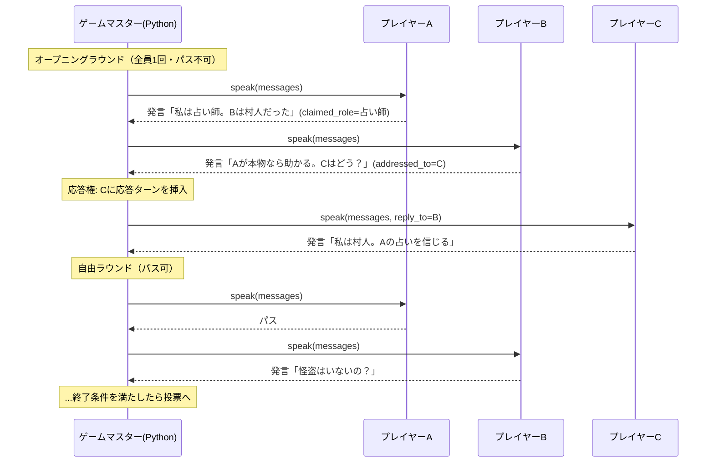
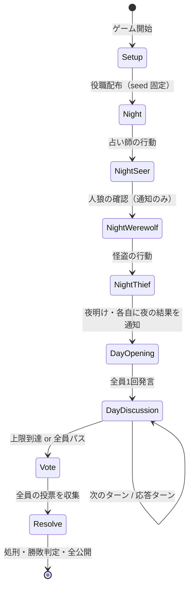

# OneNightAgents ゲーム仕様設計

本書は OneNightAgents のゲーム仕様（ルール・プレイモード・議論システム）を定める。
技術構成は [architecture.md](architecture.md)、AI プレイヤーの内部設計は [agent-design.md](agent-design.md)、実装順序は [implementation-plan.md](implementation-plan.md) を参照。

- 作成日: 2026-10-14（改訂 1: プレイヤーが Deep Agent になったことに伴い呼び出し数の記述を更新）
- ステータス: 設計案（未実装）

---

## 1. 方針

1. **初期バージョンは「ワンナイト人狼」日本版の基本ルール**（村人・人狼・占い師・怪盗、中央 2 枚）をそのまま採用する。AI が遊ぶうえでルールを変える必要はなく、既存ルールの方が検証・比較がしやすい。
2. **標準ルールと OneNightAgents 独自ルールを分離する。** 独自ルールは「議論の進行方式」「発言の形式」「タイムアウト時の扱い」など、AI がプレイするために必要な部分に限定する。
3. **勝敗判定・夜の処理・投票集計は決定的（deterministic）** とし、同じ入力から同じ結果が再現できる。LLM はプレイヤーの意思決定にのみ関与する。

---

## 2. ワンナイト人狼の基本ルール（調査結果）

### 2.1 出典と前提

- 日本版ワンナイト人狼は 2012 年にオオカミさン（奥井晶久）が発表したカードゲームで、「必ず一晩で終わる」人狼ルールである（[人狼wiki: ワンナイト人狼](https://jinrou-wiki.uhyohyo.net/wiki/%E3%83%AF%E3%83%B3%E3%83%8A%E3%82%A4%E3%83%88%E4%BA%BA%E7%8B%BC)）。
- 公式サイト（1nite-jinro.strikingly.com）は本調査時点で取得できなかったため（HTTP 403）、ルールは以下の二次資料で突き合わせた。
  - [ボドゲーマ: ワンナイト人狼のルール/インスト](https://bodoge.hoobby.net/games/one-night-werewolf/instructions/751)
  - [人狼wiki: ワンナイト人狼](https://jinrou-wiki.uhyohyo.net/wiki/%E3%83%AF%E3%83%B3%E3%83%8A%E3%82%A4%E3%83%88%E4%BA%BA%E7%8B%BC)
- 米国版 One Night Ultimate Werewolf（Bezier Games）は中央 3 枚・役職多数・夜の順序が異なる別ルールである（[RulesPal: One Night Ultimate Werewolf rulebook](https://rulespal.com/one-night-ultimate-werewolf/rulebook)）。本プロジェクトは日本版を基準にし、米国版は将来の拡張候補として扱う。

### 2.2 日本版基本ルールの要約

| 項目 | 内容 |
| --- | --- |
| 人数 | 3〜7 人 |
| カード枚数 | 人数 + 2 枚（5 人以下）。人狼 2・占い師 1・怪盗 1 が固定で、残りは村人 |
| 中央カード | 配られず残った 2 枚を伏せて中央に置く（「欠けている役職」） |
| 進行 | 夜 1 回 → 昼の議論 → 投票 1 回 → 終了 |
| 夜の順序 | 占い師 → 人狼 → 怪盗 |
| 占い師 | 他プレイヤー 1 人のカード、**または**中央 2 枚を見る |
| 人狼 | 人狼同士で互いを確認する（1 人なら一匹狼だと分かる） |
| 怪盗 | 任意で他プレイヤー 1 人とカードを交換し、交換後の自分のカードを見る。相手は交換されたことを知らない |
| 村人 | 能力なし |
| 投票 | 全員が同時に 1 人を指名。最多得票者が処刑。同票は全員処刑。全員の票がばらけた（全員 1 票）場合は誰も処刑されない |
| 勝敗 | 人狼が 1 人でも処刑されれば村人陣営の勝ち。処刑されなければ人狼陣営の勝ち |
| 平和村 | 人狼 2 枚が両方とも中央にある場合。誰も処刑しなければ村人陣営の勝ち、誰かを処刑すれば全員敗北 |
| 陣営の判定 | ゲーム終了時点で手元にあるカードで決まる（怪盗が人狼を取れば人狼陣営になる） |

米国版との主な差異（参考）:

- 中央カードが 3 枚、役職が多い（Robber / Troublemaker / Drunk / Insomniac / Minion / Tanner ほか）。
- 夜の順序が「人狼 → 占い師 → 怪盗(Robber)」。日本版は占い師が先なので、占い師は交換前の情報を見ることになる。
- 一匹狼は中央カードを 1 枚見られる。
- 「誰も 2 票以上得ていなければ誰も死なない」。全員が 1 票ずつという日本版の表現と実質同じ。

### 2.3 役職交換による情報の変化（重要）

ワンナイト人狼の面白さの核は「夜の行動で情報がずれる」ことにある。設計上押さえるべき変化を整理する。

| 行動 | 行動者が得る情報 | 行動の結果生じるズレ |
| --- | --- | --- |
| 占い師が誰かを見る | 交換前の役職（確定情報） | 直後に怪盗が交換すると占い結果が「古い」情報になる |
| 占い師が中央を見る | 中央 2 枚（＝場に存在しない役職） | 平和村かどうかを唯一知り得る |
| 人狼の確認 | 相方の有無・誰か | 怪盗に交換されると、確認した相方が村側になり本人は知らない |
| 怪盗の交換 | 自分の新しい役職 | 相手は交換を知らない。怪盗が人狼を取ると陣営が入れ替わる |

AI プレイヤーにとっては「自分の情報は確定だが古い可能性がある」「他者の発言は嘘かもしれないし、本人も知らずに間違っている可能性がある」という二重の不確実性を扱うことになる。

---

## 3. OneNightAgents の採用ルール（初期バージョン）

### 3.1 標準ルール（そのまま採用）

- プレイヤー人数 `N` は 3〜7 の範囲で設定可能。**既定は 5 人**。
  - カードは常に `N + 2` 枚、中央は常に 2 枚とする（物理版は 8 枚上限のため 7 人では中央 1 枚になるが、本プロジェクトではそろえる。これは独自ルール扱い）。
  - 5 人: カード 7 枚 = 人狼 2・占い師 1・怪盗 1・村人 3。中央 2 枚。
  - 4 人（高速テスト用）: カード 6 枚 = 人狼 2・占い師 1・怪盗 1・村人 2。
- 夜の順序は 占い師 → 人狼 → 怪盗。
- 投票・勝敗・平和村の扱いは 2.2 のとおり。
- 自分自身への投票は不可（「他プレイヤーを指名する」を厳密化）。
- ゲーム終了後に全カード（中央含む）と夜の行動を公開する。

### 3.2 OneNightAgents 独自ルール（AI プレイのための追加）

標準ルールにない、または人間同士では暗黙に処理している部分を明文化する。これらは「独自ルール」として設定で切り替え可能にする。

| 独自ルール | 内容 | 理由 |
| --- | --- | --- |
| 発話の形式 | 1 回の発言は短い文章（既定: 全角 120 文字以内相当。トークン上限で制御） | 長文独白を防ぎ、テンポを維持する |
| 発言のメタ情報 | 発言には任意で「宛先（addressed_to）」「役職の主張（claimed_role）」を付ける | 発言権の調停と、後の分析（CO 検出・嘘の分析）に使う |
| 沈黙（パス） | 発言ターンで「パス」を選べる | AI が常に喋る不自然さを避ける |
| 議論の終了条件 | 最大ラウンド数到達、または 1 ラウンド全員パス | LLM に終了判断をさせない |
| 無効な行動の扱い | ルール違反（自分に投票、存在しない対象）は 1 回だけ再要求し、再び無効なら決定的なフォールバック | ゲームを止めない |
| タイムアウト | 推論が制限時間を超えた場合もフォールバック（発言はパス、投票は有効票からランダム） | テンポ維持 |
| 役職の騙り | 嘘の役職主張は明示的に許可する（プロンプトで明記） | 人狼・怪盗の戦術として必須 |

将来の拡張候補（初期版では採用しない）:

- 吊人（処刑されると単独勝利。ハロウィンナイト人狼由来の第三陣営）
- 米国版役職（Troublemaker、Drunk、Insomniac、Minion など）
- 「最終弁論」フェーズ（投票直前に 1 人 1 回短く発言）
- 投票後の「再投票」ルール（標準ではない）

### 3.3 例外処理の定義

決定的に処理すべき例外を列挙する。

| 状況 | 処理 |
| --- | --- |
| 人狼が 2 枚とも中央 | 平和村。誰も処刑されなければ村人陣営勝利、処刑があれば「勝者なし」 |
| 最多得票が複数 | 全員処刑。処刑者に人狼が 1 人でも含まれれば村人陣営勝利 |
| 全員が 1 票ずつ | 誰も処刑されない。人狼が場にいれば人狼陣営勝利、平和村なら村人陣営勝利 |
| 怪盗が人狼のカードを取った | 怪盗は人狼陣営。元の人狼は村人陣営（怪盗役）になるが本人は知らない |
| 怪盗が交換しない | 怪盗のまま。交換後の情報は得られない |
| 怪盗が交換後に人狼になり、処刑された | 人狼が処刑されたので村人陣営勝利 |
| 占い師が中央を見る | 中央 2 枚の役職を得る。平和村の判断材料 |
| AI が無効な夜の行動を返す | 1 回再要求。再び無効なら「占い師: 中央を見る」「怪盗: 交換しない」 |
| AI の投票が無効（自分・存在しない対象） | 1 回再要求。再び無効なら有効な対象からランダム（seed 固定） |

---

## 4. プレイモード

### 4.1 比較

| モード | 内容 | 実装コスト | 価値 | 初期版での位置づけ |
| --- | --- | --- | --- | --- |
| A. 人間 1 人 + AI | 人間が 1 席を担当。入力待ちと UI が必要 | 中（入力待ち、提示方法、時間制限） | 遊びとしての面白さが最も高い | 第 2 段階 |
| B. AI 同士の完全自動対戦 | 人間の介入なし。バッチ実行で多数ゲームを回せる | 低 | 開発・検証・統計分析に最適 | **最初に実装** |
| C. AI 対戦の観戦 | B をリアルタイムに表示し、各 AI の内面も見られる | 低〜中（B のイベントを逐次表示するだけ） | 観察目的の中心 | B と同時に実装 |

### 4.2 推奨

**B（完全自動対戦）を C（観戦表示）とセットで最初に実装する。** 理由:

1. ゲームエンジン・情報隔離・ログ・LLM 接続のすべてを、UI なしで検証できる。
2. 同じエンジンをバッチ実行すれば、モデルや戦略の比較（勝率）がすぐに取れる。
3. C は B のイベントストリームを CLI に表示するだけなので、追加コストがほぼない。
4. A は「人間の入力を待つプレイヤー実装」を 1 つ追加するだけで成立するよう、プレイヤーのインターフェースを設計しておく（[architecture.md](architecture.md) 参照）。人間席は LLM 席より遅い・早いが生じるため、議論の進行制御（タイムアウト、入力催促）が別途必要になる。

---

## 5. 議論システム

### 5.1 課題の整理

議論は人狼ゲームの中核だが、AI 同士の議論には固有の問題がある。

- 完全ターン制では、全員が順番に独白するだけになり、質問や反論が成立しにくい。
- 全員同時発言は、発言の衝突・順序の不定・状態管理の複雑化を招き、さらにローカル LLM が 1 台では「同時」にならない。
- LLM の推論は 1 回あたり数秒〜数十秒かかるため、呼び出し回数がそのままテンポを決める。プレイヤーは Deep Agent なので、1 回の「判断」が内部で複数回のモデル呼び出し（メモの読み書き → 行動提出）になりうる。

先行事例として Google の Werewolf Arena（[arXiv:2407.13943](https://arxiv.org/abs/2407.13943)）は、各ターンに全員が「発言意欲」を 0〜4 で入札し、最高入札者が発言する動的ターン制を採用している（0: 聞くだけ、4: 名指しされたので応答必須。同点は直前に言及されたプレイヤーを優先した抽選。議論は 8 ターン上限）。同論文では GPT-4 の人狼が多弁になり、かえって怪しまれたという観察もある。
また、6 種類の LLM にワンナイト人狼をさせた記事（[ASCII.jp](https://ascii.jp/elem/000/004/207/4207849/)）では、1 人 1 ターンの発言だけでは騙し合いが起きず、「自分が人狼だと語ってしまう」「他者の発言をなぞるだけ」「投票を拒否する」といった問題が報告されている。

### 5.2 方式の比較

| 方式 | 自然さ | 実装難度 | 判断（エージェント起動）数 / ターン | 問題点 |
| --- | --- | --- | --- | --- |
| (1) 完全ターン制 | 低 | 低 | 1 | 独白化。質問に答える機会がない |
| (2) 自由同時発言 | 高（理論上） | 高 | N（全員生成） | 衝突・順序不定・無駄な生成。1 台の Ollama では逐次化される |
| (3) GM が発言者を決める | 中 | 低 | 1 | GM の決め方が議論の質を決める。GM を LLM にすると非決定的 |
| (4) 並行推理 + GM 調停（入札） | 高 | 中 | N（入札）+ 1（発言） | 入札のたびに全員が推論するため遅い |

### 5.3 推奨: ラウンド制 + パス + 応答権（方式 3 を決定的ルールで具体化）

入札方式（4）は自然だが、ローカル LLM では入札だけで N 回の推論が必要になり、テンポを最も悪化させる。初期版では **エージェントの起動を 1 ターン 1 回に抑えつつ、質問・反論・沈黙を成立させる** 以下の方式を採用する（1 回の起動が内部で何回モデルを呼ぶかは [agent-design.md](agent-design.md) の `ModelCallLimit` で上限を設ける）。

#### 進行ルール

1. **オープニングラウンド**: 席順（ラウンドごとに開始位置をずらす）で全員が 1 回ずつ発言する。パス不可。全員の初期主張（CO や様子見宣言）を揃える。
2. **自由ラウンド**（最大 `max_rounds` 回、既定 2）: 席順で各プレイヤーに発言ターンを与える。各ターンで発言かパスを選べる。
3. **応答権**: 発言に `addressed_to`（宛先）が付いていた場合、GM は宛先プレイヤーに即座に「応答ターン」を挿入する。応答もさらに宛先を持てるが、連鎖は 2 回まで（A→B→A で打ち切り）。1 人が 1 ラウンドに受けられる応答ターンは 1 回まで（公平性）。
4. **終了条件**: `max_rounds` を使い切る、または自由ラウンドで全員がパスしたら議論終了。
5. **投票**: 全員同時に投票（各プレイヤーに独立して投票を求める。他者の投票は見えない）。

#### 検討事項への対応

| 検討事項 | 対応 |
| --- | --- |
| 自発的に発言できる仕組み | 自由ラウンドでの発言/パス選択。エージェントは `speak` か `pass_turn` のどちらかのツールを呼ぶ |
| 他者への質問や反論 | `addressed_to` と応答権。応答ターンのメッセージには「あなたは B から問われています」を明示する |
| 嘘・役職偽装 | `claimed_role` は自己申告であり真偽を GM は検証しない。プロンプトで「嘘をついてよい」と明示 |
| 発言要求の競合 | 競合が起きない（GM が順番を割り当てる）。応答権の宛先が複数の場合は席順 |
| 発言回数の公平性 | ラウンド内で全員 1 ターン。応答ターンは 1 ラウンド 1 回まで |
| 沈黙 | パスを明示的な選択肢にする。パスはログに記録し分析対象にする |
| 会話の停滞 | 全員パスで終了。直近発言と高い類似度（単純な重複検出）の発言が続く場合は早期終了を検討（任意） |
| 議論の終了条件 | ラウンド上限と全員パス。LLM に終了を判断させない |
| 推論待ちによるテンポ | 1 ターン 1 回のエージェント起動（内部は最大 `model_call_limit` 回）。発言は短く。入札なし |

#### 想定されるエージェント起動数（5 人・自由ラウンド 2 の場合）

| フェーズ | 起動数 |
| --- | --- |
| 夜（占い師 1、怪盗 1。人狼は確認のみで呼び出し不要） | 2 |
| オープニング | 5 |
| 自由ラウンド × 2（応答ターン含めて最大 +5） | 10〜15 |
| 推理更新（任意。夜明け後と投票前） | 0〜10 |
| 投票 | 5 |
| 合計 | 22〜37 |

1 起動が内部 1〜4 回のモデル呼び出しで 10 秒なら 4〜6 分、30 秒なら 11〜18 分。実測は [implementation-plan.md](implementation-plan.md) の検証計画で行い、必要なら人数・ラウンド数・メモ更新回数を減らす。

#### 入札方式を後から試す余地

「誰が次に話すか」を決める処理は GM 内の 1 つの関数（ターンスケジューラ）に閉じる。ラウンド制で議論が不自然だと判明した場合、入札方式（全員に 0〜4 の発言意欲を `bid` ツールで問い、最高者が発言）を同じ場所に差し替えて比較する。入札はエージェント起動を N 回増やすため、トレースで時間を見てから判断する。

### 5.4 発言データの形式

発言はエージェントが `speak` ツール（またはパスなら `pass_turn`）で提出する。ツール引数は次の情報を持つ（詳細スキーマは [agent-design.md](agent-design.md)）。

- `content`: 発言本文（短文）
- `addressed_to`: 宛先プレイヤー（任意）
- `claimed_role`: この発言で主張した自分の役職（任意。嘘でもよい）
- パスは `pass_turn` ツールの呼び出しで表す
- 発言理由は公開しない。エージェントの推理メモ `/notes.md` とトレース上のモデル出力が分析対象になる

---

## 6. ゲーム進行の状態遷移

---

## 7. 設計上の未決事項（ゲーム仕様）

- 既定の人数（5 人）と自由ラウンド数（2）は実測テンポで調整する。
- 発言言語は日本語を前提にするが、ローカルモデルの日本語性能次第で英語プロンプト + 日本語出力などの構成を検討する。
- 応答権の連鎖上限（2）と 1 ラウンドの応答回数（1）は、議論の自然さを見て調整する。
- 吊人の導入時期。3 陣営になると「嘘をついて処刑されに行く」戦略が観察でき、分析対象として魅力があるが、初期版では除外する。
